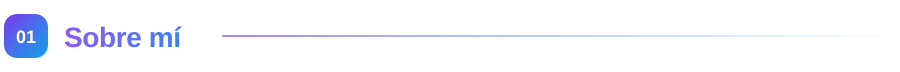
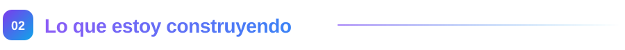
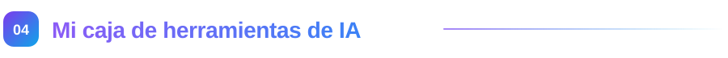
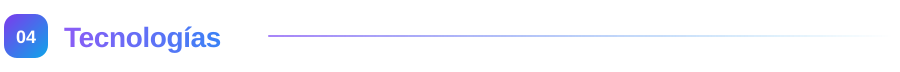
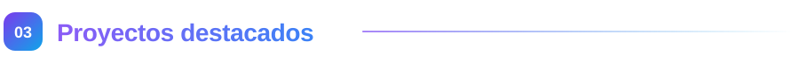

<!-- Encabezado -->
<p align="right">
  <a href="README.md">English</a> · <b>Español</b>
</p>

<p align="center">
  <picture>
    <source media="(prefers-color-scheme: dark)" srcset="assets/hero-dark.svg" />
    
  </picture>
</p>

<p align="center">
  <a href="https://git.io/typing-svg">
    
  </a>
</p>

<p align="center">
  <a href="https://robertogallardo.dev"></a>
  <a href="https://linkedin.com/in/robgallardof"></a>
  <a href="https://github.com/robgallardof?tab=repositories"></a>
</p>

<p align="center">
  
  
  
</p>

<p align="center"><b><a href="#sobre-mi">Sobre mí</a> · <a href="#construyendo">Construyendo</a> · <a href="#herramientas">Herramientas IA</a> · <a href="#tecnologias">Stack</a> · <a href="#proyectos">Proyectos</a> · <a href="#experiencia">Experiencia</a> · <a href="#estadisticas">Estadísticas</a></b></p>

<p align="center"></p>

<a id="sobre-mi"></a>
<p align="center"></p>

<table>
<tr>
<td width="55%" valign="top">

```csharp
public sealed record Developer
{
    public string Name     => "Roberto Gallardo";
    public string Role     => "Arquitecto de Software · Full Stack .NET";
    public string Location => "Guadalajara, Jalisco 🇲🇽";
    public string DotNet   => ".NET Framework 2.0 → .NET 10 / 11";
    public string[] Stack  => ["C#", "VB.NET", "Rust", "Python",
                               "Vue", "React", "Next.js",
                               "MongoDB", "SQL Server"];
    public string[] Loves  => ["Clean Architecture", "SOLID",
                               "CI/CD", "Agentes de IA y MCP"];
    public string Motto    => "Que funcione es lo mínimo. "
                            + "Que se entienda es la meta.";
}
```

</td>
<td width="45%" valign="top">

Leo el código legacy antes de juzgarlo, y luego lo dejo mejor de como lo encontré.

🏗️ **De día:** servicios backend en **.NET** para una empresa global de logística.<br/><br/>
🔄 **Todas las generaciones de .NET:** desde **.NET Framework 2.0 / 3.5 / 4.x**, pasando por .NET Core, hasta **.NET 5 → 10 y 11** — y las migraciones entre ellas.<br/><br/>
🤖 **4 años con IA:** de ChatGPT a Codex, Claude Code y Antigravity — con revisión y límites, no a ciegas.<br/><br/>
🌙 **De noche:** agentes de IA que hacen trabajo real — editan mis videos, los publican y hasta hacen mi declaración.<br/><br/>
🔨 **Ahora mismo:** construyendo [**RepoRinse**](https://github.com/robgallardof/RepoRinse) y [**Rekora**](https://github.com/robgallardof/rekora), herramientas en Rust para agentes de IA.<br/><br/>
💬 **Platícame de:** C#, migraciones de .NET, diseño de software, MongoDB, Vue/Next.js, DevOps y agentes de IA.

</td>
</tr>
</table>

<p align="center"></p>

<a id="construyendo"></a>
<p align="center"></p>

Herramientas para que los agentes de IA trabajen de forma segura y con memoria — locales, sin telemetría y en Rust.

<table>
  <tr>
    <td width="50%" valign="top">
      <h3>🧼 <a href="https://github.com/robgallardof/RepoRinse">RepoRinse</a></h3>
      <p>CLI local y determinista en Rust que mantiene limpios los repos: quita trailers de coautoría de IA (respeta a las personas), espacios e Unicode invisible, y añade límites para Claude Code, Codex, Gemini CLI y Cursor.</p>
      <p><code>Rust</code> <code>Git hooks</code> <code>Límites para agentes</code></p>
      <p>
        
        
        
      </p>
    </td>
    <td width="50%" valign="top">
      <h3>🧠 <a href="https://github.com/robgallardof/rekora">Rekora</a></h3>
      <p>Memoria local y verificable para agentes de IA de código: decisiones, restricciones y problemas conocidos con sus fuentes, marcados como desactualizados si cambia un archivo citado, servidos por CLI y servidor MCP dentro de un presupuesto de tokens. En desarrollo temprano.</p>
      <p><code>Rust</code> <code>SQLite</code> <code>MCP</code> <code>Etapa temprana</code></p>
      <p>
        
        
        
      </p>
    </td>
  </tr>
</table>

```sh
reporinse install --provider git --all --yes            # limpia cada mensaje de commit
reporinse install --provider claude,codex --all --yes   # límites para tus agentes
```

<p align="center"></p>

<a id="herramientas"></a>
<p align="center"></p>

Construyo **servidores MCP, skills y hooks** para que los agentes hagan trabajo real en mi equipo — en local y
conmigo al mando.

<table>
  <tr>
    <th width="33%">🔌 Servidores MCP</th>
    <th width="33%">🎯 Skills y roles de agentes</th>
    <th width="33%">🧠 Memoria y límites</th>
  </tr>
  <tr>
    <td valign="top">
      <a href="https://github.com/robgallardof/davinci-resolve-mcp">davinci-resolve-mcp</a> — edición de video<br/>
      <a href="https://github.com/robgallardof/social-publisher-mcp">social-publisher-mcp</a> — publicación<br/>
      <a href="https://github.com/robgallardof/declaracion">declaracion</a> — impuestos en México
    </td>
    <td valign="top">
      Productor, editores, colorista y QA para Resolve<br/>
      Copywriter, estratega y analista para redes<br/>
      Contador y auditor para declaraciones
    </td>
    <td valign="top">
      <a href="https://github.com/robgallardof/rekora">Rekora</a> — memoria verificable para agentes<br/>
      <a href="https://github.com/robgallardof/RepoRinse">RepoRinse</a> — hooks de Git y agentes<br/>
      Guardas de comandos y rutas para agentes<br/>
      Un historial de commits solo con personas
    </td>
  </tr>
</table>

<p align="center">
  
  
  
</p>

<p align="center"></p>

<a id="tecnologias"></a>
<p align="center"></p>

<p align="center">
  <b>Backend</b><br/><br/>
  
</p>
<p align="center">
  <b>Frontend</b><br/><br/>
  
</p>
<p align="center">
  <b>Datos · Nube · DevOps</b><br/><br/>
  
</p>
<p align="center">
  <b>Herramientas</b><br/><br/>
  
</p>

<p align="center">
  <b>IA y agentes</b><br/><br/>
  
  
  
  
  
  
  
  
  
</p>
<p align="center">
  <b>Contenido y automatización</b><br/><br/>
  
  
  
  
  
  
  
  
</p>

<p align="center">
  
  
  
  
  
  
  
</p>

<p align="center"></p>

<a id="proyectos"></a>
<p align="center"></p>

<table>
  <tr>
    <td width="50%" valign="top">
      <h3>🎬 <a href="https://github.com/robgallardof/davinci-resolve-mcp">davinci-resolve-mcp</a></h3>
      <p>Edita en DaVinci Resolve hablando con una IA que trabaja como productor: cortes verticales y horizontales, movimiento que no corta caras, subtítulos con diseño, música a tiempo y revisión antes de cada render.</p>
      <p><code>MCP</code> <code>Python</code> <code>Video</code></p>
      <p>
        
        
        
      </p>
    </td>
    <td width="50%" valign="top">
      <h3>📲 <a href="https://github.com/robgallardof/social-publisher-mcp">social-publisher-mcp</a></h3>
      <p>Un community manager con IA para video corto, como servidor MCP: ve tus videos, escribe el copy de cada red, programa a las 05:00 y te dice qué funcionó.</p>
      <p><code>MCP</code> <code>Python</code> <code>Redes</code></p>
      <p>
        
        
        
      </p>
    </td>
  </tr>
  <tr>
    <td width="50%" valign="top">
      <h3>🧾 <a href="https://github.com/robgallardof/declaracion">declaracion</a></h3>
      <p>Tu asistente de impuestos personales en México dentro de tu agente de IA: lee CFDI, calcula ISR e IVA (RESICO) y te guía al declarar. Tus datos se quedan en tu PC.</p>
      <p><code>MCP</code> <code>Python</code> <code>SAT</code></p>
      <p>
        
        
        
      </p>
    </td>
    <td width="50%" valign="top">
      <h3>📚 <a href="https://github.com/robgallardof/wikdoc">wikdoc</a></h3>
      <p>Convierte cualquier carpeta de código en una base de conocimiento local con la que puedes chatear — embeddings + RAG con Ollama, nada sale de tu equipo.</p>
      <p><code>Python</code> <code>Ollama</code> <code>RAG</code></p>
      <p>
        
        
        
      </p>
    </td>
  </tr>
  <tr>
    <td width="50%" valign="top">
      <h3>🤖 <a href="https://github.com/robgallardof/wallybot">wallybot</a></h3>
      <p>Centro autoalojado de análisis de mercado, cartera y trading asistido por IA: propuestas explicadas, tu aprobación y controles de riesgo.</p>
      <p><code>Python</code> <code>Autoalojado</code></p>
      <p>
        
        
        
      </p>
    </td>
    <td width="50%" valign="top">
      <h3>🦊 <a href="https://github.com/robgallardof/multig">multig</a></h3>
      <p>Administra muchos perfiles de navegador persistentes y aislados con Camoufox, un panel en Next.js y un backend en Python.</p>
      <p><code>Next.js</code> <code>Python</code> <code>Camoufox</code></p>
      <p>
        
        
        
      </p>
    </td>
  </tr>
  <tr>
    <td width="50%" valign="top">
      <h3>⚡ <a href="https://github.com/robgallardof/arquest">arquest</a></h3>
      <p>Cliente HTTP estilo Postman/Thunder con Next.js App Router: interfaz pensada en modo oscuro y PWA instalable con caché offline.</p>
      <p><code>Next.js</code> <code>PWA</code></p>
      <p>
        
        
        
      </p>
    </td>
    <td width="50%" valign="top">
      <h3>🎮 <a href="https://github.com/robgallardof/ruxtbot">ruxtbot</a></h3>
      <p>Bot de Discord para Rust: planeación de raids con imágenes, crafteo, servidores en vivo, búsqueda de jugadores y alertas de BattleMetrics, en inglés y español.</p>
      <p><code>Discord</code> <code>Bot</code></p>
      <p>
        
        
        
      </p>
    </td>
  </tr>
</table>

<p align="center">
  <a href="https://github.com/robgallardof?tab=repositories"><b>➜ Ver todos los repositorios</b></a>
</p>

<p align="center"></p>

<a id="experiencia"></a>
<p align="center"></p>

| Sector | Puesto | Periodo |
|---|---|---|
| 🚚 **Logística global** | Desarrollador Full Stack .NET — .NET 8, Clean Architecture, CQRS, Docker/K8s, Azure DevOps, Vue, MongoDB | 2023 – actual |
| 🏦 **Banca** | Desarrollador .NET — .NET Framework → .NET 5, biometría, GCM → FCM, Kotlin | 2022 |
| 📡 **Telecomunicaciones** | Desarrollador — VB.NET / C# / Java, SQL Server, SSRS, Mulesoft | 2019 – 2022 |

### 🎓 Formación

| | Grado | Institución |
|---|---|---|
| 🎓 | **Maestría en Arquitectura de Software** | Università degli Studi Guglielmo Marconi · cursada en AICAD Business School |
| 🎓 | **Licenciatura en Sistemas Computacionales Administrativos** | Universidad Veracruzana |

<p align="center"></p>

<a id="estadisticas"></a>
<p align="center"></p>

<p align="center">
  
</p>
<p align="center">
  
  
</p>
<p align="center">
  
  
</p>
<p align="center">
  <a href="https://git.io/streak-stats"></a>
</p>

### 🐍 Serpiente de contribuciones

<p align="center">
  <picture>
    <source media="(prefers-color-scheme: dark)" srcset="https://raw.githubusercontent.com/robgallardof/robgallardof/output/github-snake-dark.svg" />
    <source media="(prefers-color-scheme: light)" srcset="https://raw.githubusercontent.com/robgallardof/robgallardof/output/github-snake.svg" />
    
  </picture>
</p>

<p align="center"></p>

<p align="center">
  <i>“Primero que funcione, luego que esté bien, luego que sea rápido.” — Kent Beck</i>
</p>


