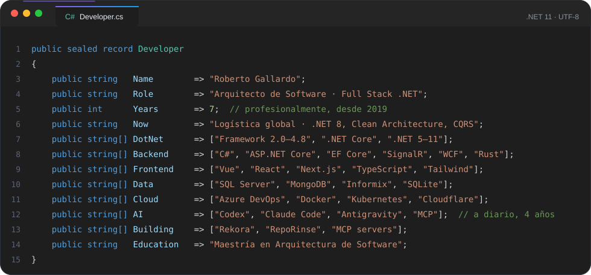
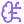
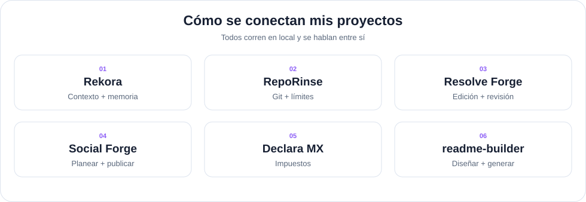
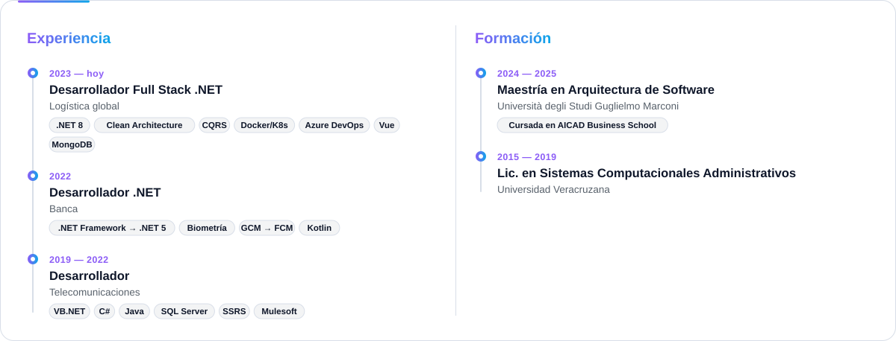
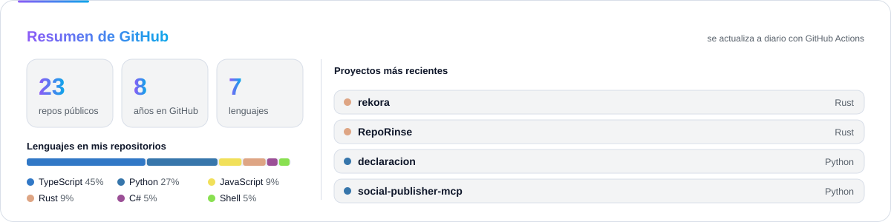

<a id="top"></a>

<!-- Encabezado -->
<p align="right">
  <a href="README.md">English</a> · <b>Español</b>
</p>

<p align="center">
  <picture>
    <source media="(prefers-color-scheme: dark)" srcset="assets/hero-dark.svg" />
    
  </picture>
</p>

<p align="center">
  <a href="https://robertogallardo.dev"></a>
  <a href="https://linkedin.com/in/robgallardof"></a>
  <a href="https://github.com/robgallardof?tab=repositories"></a>
</p>

<p align="center">
  
  
  
</p>

<p align="center">7+ años construyendo software · .NET Framework 2.0 → 11 · 4 años con agentes de IA · Maestría en Arquitectura de Software · bilingüe</p>

<p align="center">
  <a href="#sobre-mi"></a>
  <a href="#construyendo"></a>
  <a href="#herramientas"></a>
  <a href="#tecnologias"></a>
  <a href="#proyectos"></a>
  <a href="#experiencia"></a>
  <a href="#estadisticas"></a>
<a href="#arcade"></a>
</p>

<a id="sobre-mi"></a>
##  Sobre mí

<p align="center"></p>

<p align="center"><i>Leo el código legacy antes de juzgarlo, y luego lo dejo mejor de como lo encontré.</i></p>

<table align="center" width="100%">
<tr>
<td width="50%" valign="top" align="center">

 **De día:** servicios backend en **.NET** para una empresa global de logística.

</td>
<td width="50%" valign="top" align="center">

 **Todas las generaciones de .NET:** desde **.NET Framework 2.0 / 3.5 / 4.x**, pasando por .NET Core, hasta **.NET 5 → 10 y 11** — y las migraciones entre ellas.

</td>
</tr>
<tr>
<td width="50%" valign="top" align="center">

 **4 años con IA:** de ChatGPT a Codex, Claude Code y Antigravity — con revisión y límites, no a ciegas.

</td>
<td width="50%" valign="top" align="center">

 **De noche:** agentes de IA que hacen trabajo real — editan mis videos, los publican y hasta hacen mi declaración.

</td>
</tr>
<tr>
<td width="50%" valign="top" align="center">

 **Ahora mismo:** construyendo [**RepoRinse**](https://github.com/robgallardof/RepoRinse) y [**Rekora**](https://github.com/robgallardof/rekora), herramientas en Rust para agentes de IA.

</td>
<td width="50%" valign="top" align="center">

 **Platícame de:** C#, migraciones de .NET, diseño de software, MongoDB, Vue/Next.js, DevOps y agentes de IA.

</td>
</tr>
</table>

<a id="construyendo"></a>
##  Lo que estoy construyendo

Herramientas locales para que los agentes de IA trabajen de forma segura, recuerden lo importante y muestren su actividad, sin telemetría.

-  **[Rekora](https://github.com/robgallardof/rekora)** — memoria verificable para agentes: cada decisión cita su fuente, lo desactualizado se marca y las tareas pasan limpias entre Claude Code, Codex, OpenCode y DeepSeek Harness.
-  **[RepoRinse](https://github.com/robgallardof/RepoRinse)** — historial de commits limpio y hooks de límites para Claude Code, Codex, Gemini CLI, Cursor, OpenCode y DeepSeek Harness.

-  **[Agent Mods](https://github.com/robgallardof/agent-mods)** — paneles nativos de Claude Code instalables por separado para uso de sesión, cuotas, Git, memoria y herramientas.

```sh
reporinse install --provider git --all --yes            # limpia cada mensaje de commit
reporinse install --provider opencode,deepseek --all --yes   # límites para tus agentes
rekora agent install claude --confirm                   # dale memoria a Claude Code
```

<a id="proyectos"></a>
##  Proyectos destacados

<table align="center" width="100%">
  <tr>
    <td width="50%" valign="top" align="center">
      <h3 align="center"> <a href="https://github.com/robgallardof/rekora">Rekora</a></h3>
      <p>Memoria local y verificable para agentes de IA de código: decisiones y restricciones con sus fuentes, detección de desactualizados, tareas y handoffs entre agentes, servida por MCP a Claude Code, Codex, OpenCode y DeepSeek Harness.</p>
      <p><code> Nuevo</code> <code>Rust</code> <code>MCP</code> <code>SQLite</code></p>
      <p>
        <a href="https://github.com/robgallardof/rekora"></a>
        <a href="https://github.com/robgallardof/rekora/stargazers"></a>
        <a href="https://github.com/robgallardof/rekora/commits"></a>
      </p>
    </td>
    <td width="50%" valign="top" align="center">
      <h3 align="center"> <a href="https://github.com/robgallardof/RepoRinse">RepoRinse</a></h3>
      <p>Mantiene limpios los repos y a los agentes bajo control: quita trailers de coautoría de IA (respeta a las personas), espacios e Unicode invisible, y agrega hooks de límites para Claude Code, Codex, Gemini CLI, Cursor, OpenCode y DeepSeek Harness.</p>
      <p><code> Nuevo</code> <code>Rust</code> <code>Git hooks</code> <code>Hooks de agentes</code></p>
      <p>
        <a href="https://github.com/robgallardof/RepoRinse"></a>
        <a href="https://github.com/robgallardof/RepoRinse/stargazers"></a>
        <a href="https://github.com/robgallardof/RepoRinse/commits"></a>
      </p>
    </td>
  </tr>
  <tr>
    <td width="50%" valign="top" align="center">
      <h3 align="center"> <a href="https://github.com/robgallardof/davinci-resolve-mcp">davinci-resolve-mcp</a></h3>
      <p>Edita en DaVinci Resolve hablando con un productor de IA: cortes verticales y horizontales, movimiento que no corta caras, subtítulos con diseño, música a tiempo y revisión antes de cada render.</p>
      <p><code>MCP</code> <code>Python</code> <code>Video</code></p>
      <p>
        <a href="https://github.com/robgallardof/davinci-resolve-mcp"></a>
        <a href="https://github.com/robgallardof/davinci-resolve-mcp/stargazers"></a>
        <a href="https://github.com/robgallardof/davinci-resolve-mcp/commits"></a>
      </p>
    </td>
    <td width="50%" valign="top" align="center">
      <h3 align="center"> <a href="https://github.com/robgallardof/social-publisher-mcp">social-publisher-mcp</a></h3>
      <p>Un community manager con IA para video corto: ve tus videos, escribe el texto de cada red, programa las publicaciones y te dice qué funcionó.</p>
      <p><code>MCP</code> <code>Python</code> <code>Redes</code></p>
      <p>
        <a href="https://github.com/robgallardof/social-publisher-mcp"></a>
        <a href="https://github.com/robgallardof/social-publisher-mcp/stargazers"></a>
        <a href="https://github.com/robgallardof/social-publisher-mcp/commits"></a>
      </p>
    </td>
  </tr>
  <tr>
    <td width="50%" valign="top" align="center">
      <h3 align="center"> <a href="https://github.com/robgallardof/declaracion">declaracion</a></h3>
      <p>Tu asistente de impuestos personales en México dentro de tu agente de IA: lee CFDI, calcula ISR e IVA (RESICO) y te guía al declarar. Tus datos se quedan en tu PC.</p>
      <p><code>MCP</code> <code>Python</code> <code>SAT</code></p>
      <p>
        <a href="https://github.com/robgallardof/declaracion"></a>
        <a href="https://github.com/robgallardof/declaracion/stargazers"></a>
        <a href="https://github.com/robgallardof/declaracion/commits"></a>
      </p>
    </td>
    <td width="50%" valign="top" align="center">
      <h3 align="center"> <a href="https://github.com/robgallardof/wikdoc">wikdoc</a></h3>
      <p>Convierte cualquier carpeta de código en una base de conocimiento local con la que puedes chatear — embeddings + RAG con Ollama, nada sale de tu equipo.</p>
      <p><code>Python</code> <code>Ollama</code> <code>RAG</code></p>
      <p>
        <a href="https://github.com/robgallardof/wikdoc"></a>
        <a href="https://github.com/robgallardof/wikdoc/stargazers"></a>
        <a href="https://github.com/robgallardof/wikdoc/commits"></a>
      </p>
    </td>
  </tr>
  <tr>
    <td width="50%" valign="top" align="center">
      <h3 align="center"> <a href="https://github.com/robgallardof/wallybot">wallybot</a></h3>
      <p>Centro autoalojado de análisis de mercado, cartera y trading asistido por IA: propuestas explicadas, tu aprobación y controles de riesgo.</p>
      <p><code>Python</code> <code>IA</code> <code>Autoalojado</code></p>
      <p>
        <a href="https://github.com/robgallardof/wallybot"></a>
        <a href="https://github.com/robgallardof/wallybot/stargazers"></a>
        <a href="https://github.com/robgallardof/wallybot/commits"></a>
      </p>
    </td>
    <td width="50%" valign="top" align="center">
      <h3 align="center"> <a href="https://github.com/robgallardof/multig">multig</a></h3>
      <p>Administra muchos perfiles de navegador persistentes y aislados con Camoufox, un panel en Next.js y un backend en Python.</p>
      <p><code>Next.js</code> <code>Python</code> <code>Camoufox</code></p>
      <p>
        <a href="https://github.com/robgallardof/multig"></a>
        <a href="https://github.com/robgallardof/multig/stargazers"></a>
        <a href="https://github.com/robgallardof/multig/commits"></a>
      </p>
    </td>
  </tr>
  <tr>
    <td width="50%" valign="top" align="center">
      <h3 align="center"> <a href="https://github.com/robgallardof/readme-builder">readme-builder</a></h3>
      <p>Sistema reutilizable para READMEs: prompts, widgets SVG originales, separadores y generador sin conexion.</p>
      <p><code>Python</code> <code>SVG</code> <code>EN / ES</code> <code>Offline</code></p>
    </td>
    <td width="50%" valign="top" align="center">
      <h3 align="center"> <a href="https://github.com/robgallardof/agent-mods">Agent Mods</a></h3>
      <p>Mira qué está usando tu sesión: contexto, coste, cuotas, rama Git, herramientas MCP disponibles, memoria y actividad de herramientas. Seis mods nativos de Claude Code; instala solo los que necesites.</p>
      <p><code>Mods nativos</code> <code>Claude Code</code> <code>A tu medida</code></p>
      <p><a href="https://github.com/robgallardof/agent-mods/actions"></a></p>
    </td>
  </tr>
</table>

<p align="center"><a href="https://github.com/robgallardof?tab=repositories"><b> Ver todos los repositorios</b></a></p>

<a id="herramientas"></a>
##  Mi caja de herramientas de IA

<p align="center"><picture><source media="(prefers-color-scheme: dark)" srcset="assets/widgets/ecosystem-es-dark.svg" /></picture></p>


Construyo **servidores MCP, skills, hooks y mods nativos** para que los agentes hagan trabajo real en mi equipo — en local y
conmigo al mando.

<table align="center" width="100%">
  <tr>
    <th width="33%"> Servidores MCP</th>
    <th width="33%"> Skills y roles de agentes</th>
    <th width="33%"> Memoria y límites</th>
  </tr>
  <tr>
    <td valign="top">
      <a href="https://github.com/robgallardof/davinci-resolve-mcp">davinci-resolve-mcp</a> — edición de video<br/>
      <a href="https://github.com/robgallardof/social-publisher-mcp">social-publisher-mcp</a> — publicación<br/>
      <a href="https://github.com/robgallardof/declaracion">declaracion</a> — impuestos en México
    </td>
    <td valign="top">
      Productor, editores, colorista y QA para Resolve<br/>
      Copywriter, estratega y analista para redes<br/>
      Contador y auditor para declaraciones
    </td>
    <td valign="top">
      <a href="https://github.com/robgallardof/rekora">Rekora</a> — memoria verificable para agentes<br/>
      <a href="https://github.com/robgallardof/RepoRinse">RepoRinse</a> — hooks de Git y agentes<br/>
      Guardas de comandos y rutas para agentes<br/>
      Un historial de commits solo con personas
    </td>
  </tr>
</table>

<p align="center">
  
  
  
</p>

<p align="center"><b>Mods nativos · Claude Code</b><br/><a href="https://github.com/robgallardof/agent-mods">Agent Mods</a> muestra los datos de tu sesión dentro del agente. Elige cada mod por separado; la validación, las pruebas de eventos y la instalación real se comprueban en Windows y Linux.</p>

<p align="center">Adaptadores por proyecto para OpenCode y DeepSeek Harness; Docker opcional con puertos configurables. Pruebas de hosts reales en CI.<br/><a href="https://github.com/robgallardof/rekora/blob/main/docs/architecture/ADAPTERS.md">MCP adapters</a> · <a href="https://github.com/robgallardof/RepoRinse/blob/main/docs/integrations/opencode-deepseek.md">Agent hooks</a></p>

<p align="center"><picture><source media="(prefers-color-scheme: dark)" srcset="assets/widgets/workflow-es-dark.svg" /></picture></p>

<a id="experiencia"></a>
##  Experiencia y formación

<p align="center">
  <picture>
    <source media="(prefers-color-scheme: dark)" srcset="assets/widgets/timeline-es-dark.svg" />
    
  </picture>
</p>

<a id="tecnologias"></a>
##  Tecnologías

<table align="center" width="100%">
<tr>
<td width="50%" valign="top" align="center">

<h3 align="center"> Backend</h3>
<p align="center">
  <br/><br/>
  <code>.NET Framework 2.0–4.8</code> <code>.NET Core</code> <code>.NET 5–11</code> <code>ASP.NET Core</code> <code>Minimal APIs</code> <code>EF Core</code> <code>SignalR</code> <code>WCF</code> <code>ASP.NET Web Forms</code> <code>VB.NET</code> <code>Autenticación JWT</code> <code>xUnit + Moq</code> <code>Mulesoft (SOA)</code>
</p>

</td>
<td width="50%" valign="top" align="center">

<h3 align="center"> Frontend</h3>
<p align="center">
  <br/><br/>
  <code>React Native</code> <code>shadcn/ui</code> <code>Framer Motion</code> <code>PWA</code> <code>i18n</code> <code>Accesibilidad</code>
</p>

</td>
</tr>
<tr>
<td width="50%" valign="top" align="center">

<h3 align="center"> Datos y nube</h3>
<p align="center">
  <br/><br/>
  <code>SQL Server</code> <code>MongoDB Atlas</code> <code>Pipelines de agregación</code> <code>Informix</code> <code>SSRS</code> <code>SQLite · FTS5</code> <code>Azure Blob · SAS</code> <code>Cloudflare Zero Trust</code>
</p>

</td>
<td width="50%" valign="top" align="center">

<h3 align="center"> DevOps y herramientas</h3>
<p align="center">
  <br/><br/>
  <code>Azure DevOps</code> <code>CI/CD</code> <code>Jira</code> <code>Tree-sitter</code> <code>PDFSharp · iText7</code>
</p>

</td>
</tr>
<tr>
<td width="50%" valign="top" align="center">

<h3 align="center"> Arquitectura y prácticas</h3>
<p align="center">
  <code>Clean Architecture</code> <code>CQRS</code> <code>SOLID · DRY · KISS</code> <code>Microservicios</code> <code>Diseño de APIs REST</code> <code>Modernización de legacy</code> <code>Revisión de código</code> <code>Pruebas unitarias e integración</code> <code>Documentación técnica</code>
</p>

</td>
<td width="50%" valign="top" align="center">

<h3 align="center"> IA y agentes</h3>
<p align="center">
  
  
  
  
  
  
  
  
  
  
  
  
  
</p>

</td>
</tr>
<tr>
<td colspan="2" width="100%" valign="top">

<h3 align="center"> Contenido y automatización</h3>
<p align="center">
  
  
  
  
  
  
  
  
  
  
</p>

</td>
</tr>
</table>

<a id="estadisticas"></a>
##  Estadísticas de GitHub

<p align="center">
  <picture>
    <source media="(prefers-color-scheme: dark)" srcset="assets/widgets/overview-es-dark.svg" />
    
  </picture>
</p>

<table align="center" width="100%">
<tr>
<td width="50%" align="center"><picture><source media="(prefers-color-scheme: dark)" srcset="./profile-summary-card-output/github_dark/1-repos-per-language.svg" /></picture></td>
<td width="50%" align="center"><picture><source media="(prefers-color-scheme: dark)" srcset="./profile-summary-card-output/github_dark/2-most-commit-language.svg" /></picture></td>
</tr>
<tr>
<td width="50%" align="center"><picture><source media="(prefers-color-scheme: dark)" srcset="./profile-summary-card-output/github_dark/3-stats.svg" /></picture></td>
<td width="50%" align="center"><picture><source media="(prefers-color-scheme: dark)" srcset="./profile-summary-card-output/github_dark/4-productive-time.svg" /></picture></td>
</tr>
</table>

<table align="center" width="100%">
<tr>
<td colspan="2" width="100%" valign="top">

<h3 align="center"> Racha</h3>
<p align="center"><a href="https://git.io/streak-stats"><picture><source media="(prefers-color-scheme: dark)" srcset="https://streak-stats.demolab.com?user=robgallardof&hide_border=true&date_format=j%20M%5B%20Y%5D&theme=github-dark-blue" /></picture></a></p>

</td>
</tr>
<tr>
<td colspan="2" width="100%" valign="top">

<h3 align="center"> Actividad reciente</h3>

<!--START_SECTION:activity-->
1. 🎉 Merged PR [#2](https://github.com/robgallardof/control-api/pull/2) in [robgallardof/control-api](https://github.com/robgallardof/control-api)
<!--END_SECTION:activity-->

</td>
</tr>
</table>

<a id="arcade"></a>
## Arcade de contribuciones
<p align="center"><a href="https://github.com/robgallardof?tab=overview"><picture><source media="(prefers-color-scheme: dark)" srcset="https://raw.githubusercontent.com/robgallardof/robgallardof/output/contributions-dark.svg" /></picture></a></p>
<p align="center"><sub>Mi calendario real de GitHub, actualizado cada hora. Las contribuciones incluyen commits y otras actividades registradas por GitHub.</sub></p>
<h3 align="center">Pac-Man</h3>
<p align="center"><picture>
  <source media="(prefers-color-scheme: dark)" srcset="https://raw.githubusercontent.com/robgallardof/robgallardof/output/pacman-contribution-graph-dark.svg" />
  
</picture></p>
<p align="center"><sub>Refreshed hourly with <a href="https://github.com/abozanona/pacman-contribution-graph">Arcade Contribution Graph</a> and <a href="https://github.com/Platane/snk">snk</a>.</sub></p>
<h3 align="center"> Serpiente de contribuciones</h3>

<p align="center">
  <picture>
    <source media="(prefers-color-scheme: dark)" srcset="https://raw.githubusercontent.com/robgallardof/robgallardof/output/github-snake-dark.svg" />
    <source media="(prefers-color-scheme: light)" srcset="https://raw.githubusercontent.com/robgallardof/robgallardof/output/github-snake.svg" />
    
  </picture>
</p>

<p align="center">
  <i>“Primero que funcione, luego que esté bien, luego que sea rápido.” — Kent Beck</i>
</p>

<p align="center"><a href="#top">Volver al inicio</a></p>

<!-- readme-builder:signature:start -->
<p align="center"><a href="https://github.com/robgallardof"><picture><source media="(prefers-color-scheme: dark)" srcset="assets/readme/brand/signature-es-dark.svg" /></picture></a></p>
<!-- readme-builder:signature:end -->
