

<!-- kit:lang -->

<a href="README.md"><picture><source media="(prefers-color-scheme: dark)" srcset="assets/kit/lang-es-01-dark.svg" /></picture></a>&nbsp;
<a href="README.es.md"><picture><source media="(prefers-color-scheme: dark)" srcset="assets/kit/lang-es-02-dark.svg" /></picture></a>

<!-- /kit:lang -->

<picture><source media="(prefers-color-scheme: dark)" srcset="assets/hero-dark.svg" /></picture>

<!-- kit:links -->

<a href="https://robertogallardo.dev"><picture><source media="(prefers-color-scheme: dark)" srcset="assets/kit/links-es-01-dark.svg" /></picture></a>&nbsp;
<a href="https://linkedin.com/in/robgallardof"><picture><source media="(prefers-color-scheme: dark)" srcset="assets/kit/links-es-02-dark.svg" /></picture></a>&nbsp;
<a href="https://github.com/robgallardof?tab=repositories"><picture><source media="(prefers-color-scheme: dark)" srcset="assets/kit/links-es-03-dark.svg" /></picture></a>

<!-- /kit:links -->

  
  

<!-- kit:facts -->

<picture><source media="(prefers-color-scheme: dark)" srcset="assets/kit/facts-es-dark.svg" /></picture>

<!-- /kit:facts -->

<!-- kit:nav -->

<a href="#sobre-mi"><picture><source media="(prefers-color-scheme: dark)" srcset="assets/kit/nav-es-01-dark.svg" /></picture></a>&nbsp;
<a href="#construyendo"><picture><source media="(prefers-color-scheme: dark)" srcset="assets/kit/nav-es-02-dark.svg" /></picture></a>&nbsp;
<a href="#proyectos"><picture><source media="(prefers-color-scheme: dark)" srcset="assets/kit/nav-es-03-dark.svg" /></picture></a>&nbsp;
<a href="#herramientas"><picture><source media="(prefers-color-scheme: dark)" srcset="assets/kit/nav-es-04-dark.svg" /></picture></a>&nbsp;
<a href="#experiencia"><picture><source media="(prefers-color-scheme: dark)" srcset="assets/kit/nav-es-05-dark.svg" /></picture></a>&nbsp;
<a href="#tecnologias"><picture><source media="(prefers-color-scheme: dark)" srcset="assets/kit/nav-es-06-dark.svg" /></picture></a>&nbsp;
<a href="#estadisticas"><picture><source media="(prefers-color-scheme: dark)" srcset="assets/kit/nav-es-07-dark.svg" /></picture></a>

<!-- /kit:nav -->

<!-- kit:wave -->

<!-- /kit:wave -->

<!-- kit:h-about -->

<picture><source media="(prefers-color-scheme: dark)" srcset="assets/kit/h-about-es-dark.svg" /></picture>

<!-- /kit:h-about -->

<!-- kit:about -->

<picture><source media="(prefers-color-scheme: dark)" srcset="assets/kit/about-es-dark.svg" /></picture>

<!-- /kit:about -->

<!-- kit:wave -->

<!-- /kit:wave -->

<!-- kit:h-building -->

<picture><source media="(prefers-color-scheme: dark)" srcset="assets/kit/h-building-es-dark.svg" /></picture>

<!-- /kit:h-building -->

Herramientas locales para que los agentes de IA trabajen con seguridad, recuerden lo importante y muestren lo que pasa en la sesión. Sin telemetría.

<!-- kit:building -->

<picture><source media="(prefers-color-scheme: dark)" srcset="assets/kit/building-es-dark.svg" />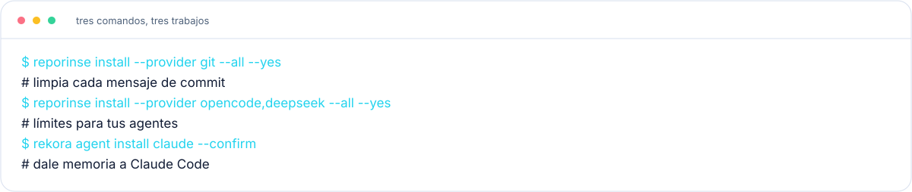</picture>

<!-- /kit:building -->

<!-- kit:wave -->

<!-- /kit:wave -->

<!-- kit:h-projects -->

<picture><source media="(prefers-color-scheme: dark)" srcset="assets/kit/h-projects-es-dark.svg" /></picture>

<!-- /kit:h-projects -->

<!-- kit:projects -->

<a href="https://github.com/robgallardof/rekora"><picture><source media="(prefers-color-scheme: dark)" srcset="assets/kit/projects-es-01-dark.svg" />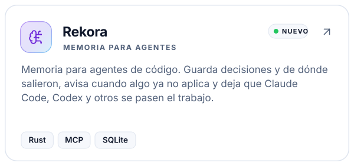</picture></a><a href="https://github.com/robgallardof/RepoRinse"><picture><source media="(prefers-color-scheme: dark)" srcset="assets/kit/projects-es-02-dark.svg" />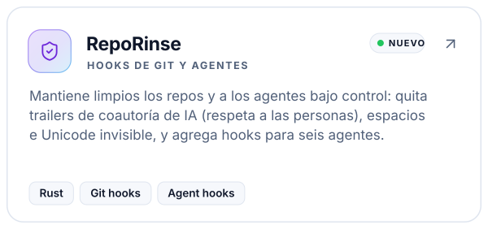</picture></a><a href="https://github.com/robgallardof/davinci-resolve-mcp"><picture><source media="(prefers-color-scheme: dark)" srcset="assets/kit/projects-es-03-dark.svg" />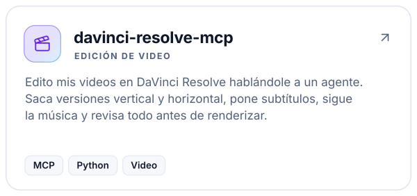</picture></a><a href="https://github.com/robgallardof/social-publisher-mcp"><picture><source media="(prefers-color-scheme: dark)" srcset="assets/kit/projects-es-04-dark.svg" />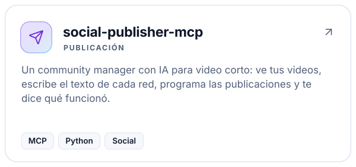</picture></a><a href="https://github.com/robgallardof/declaracion"><picture><source media="(prefers-color-scheme: dark)" srcset="assets/kit/projects-es-05-dark.svg" />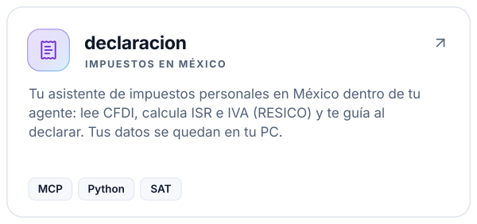</picture></a><a href="https://github.com/robgallardof/agent-mods"><picture><source media="(prefers-color-scheme: dark)" srcset="assets/kit/projects-es-06-dark.svg" />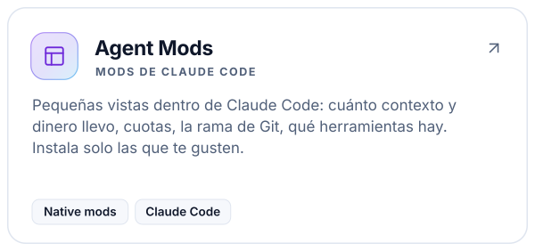</picture></a><a href="https://github.com/robgallardof/readme-builder"><picture><source media="(prefers-color-scheme: dark)" srcset="assets/kit/projects-es-07-dark.svg" /></picture></a><a href="https://github.com/robgallardof/wikdoc"><picture><source media="(prefers-color-scheme: dark)" srcset="assets/kit/projects-es-08-dark.svg" /></picture></a><a href="https://github.com/robgallardof/wallybot"><picture><source media="(prefers-color-scheme: dark)" srcset="assets/kit/projects-es-09-dark.svg" />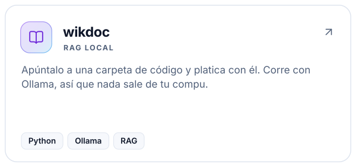</picture></a><a href="https://github.com/robgallardof/multig"><picture><source media="(prefers-color-scheme: dark)" srcset="assets/kit/projects-es-10-dark.svg" /></picture></a>

<!-- /kit:projects -->

<!-- kit:all-repos -->

<a href="https://github.com/robgallardof?tab=repositories"><picture><source media="(prefers-color-scheme: dark)" srcset="assets/kit/all-repos-es-01-dark.svg" /></picture></a>

<!-- /kit:all-repos -->

<!-- kit:wave -->

<!-- /kit:wave -->

<!-- kit:h-toolbox -->

<picture><source media="(prefers-color-scheme: dark)" srcset="assets/kit/h-toolbox-es-dark.svg" /></picture>

<!-- /kit:h-toolbox -->

<picture><source media="(prefers-color-scheme: dark)" srcset="assets/widgets/ecosystem-es-dark.svg" /></picture>

<!-- kit:toolbox -->

<picture><source media="(prefers-color-scheme: dark)" srcset="assets/kit/toolbox-es-dark.svg" />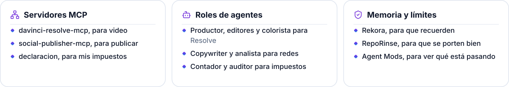</picture>

<!-- /kit:toolbox -->

Construyo <b>servidores MCP, skills, hooks y mods nativos</b> para que los agentes hagan trabajo real en mi equipo, en local y conmigo al mando. Adaptadores por proyecto para OpenCode y DeepSeek Harness; pruebas reales en CI.

<!-- kit:toolbox-links -->

<a href="https://github.com/robgallardof/rekora/blob/main/docs/architecture/ADAPTERS.md"><picture><source media="(prefers-color-scheme: dark)" srcset="assets/kit/toolbox-links-es-01-dark.svg" /></picture></a>&nbsp;
<a href="https://github.com/robgallardof/RepoRinse/blob/main/docs/integrations/opencode-deepseek.md"><picture><source media="(prefers-color-scheme: dark)" srcset="assets/kit/toolbox-links-es-02-dark.svg" /></picture></a>

<!-- /kit:toolbox-links -->

<picture><source media="(prefers-color-scheme: dark)" srcset="assets/widgets/workflow-es-dark.svg" /></picture>

<!-- kit:wave -->

<!-- /kit:wave -->

<!-- kit:h-experience -->

<picture><source media="(prefers-color-scheme: dark)" srcset="assets/kit/h-experience-es-dark.svg" /></picture>

<!-- /kit:h-experience -->

<picture><source media="(prefers-color-scheme: dark)" srcset="assets/widgets/timeline-es-dark.svg" /></picture>

<!-- kit:wave -->

<!-- /kit:wave -->

<!-- kit:h-stack -->

<picture><source media="(prefers-color-scheme: dark)" srcset="assets/kit/h-stack-es-dark.svg" /></picture>

<!-- /kit:h-stack -->

<!-- kit:stack -->

<picture><source media="(prefers-color-scheme: dark)" srcset="assets/kit/stack-es-dark.svg" /></picture>

<!-- /kit:stack -->

<!-- kit:wave -->

<!-- /kit:wave -->

<!-- kit:h-stats -->

<picture><source media="(prefers-color-scheme: dark)" srcset="assets/kit/h-stats-es-dark.svg" /></picture>

<!-- /kit:h-stats -->

<picture><source media="(prefers-color-scheme: dark)" srcset="assets/widgets/overview-es-dark.svg" /></picture>

<picture><source media="(prefers-color-scheme: dark)" srcset="./profile-summary-card-output/github_dark/1-repos-per-language.svg" /></picture><picture><source media="(prefers-color-scheme: dark)" srcset="./profile-summary-card-output/github_dark/2-most-commit-language.svg" /></picture>

<picture><source media="(prefers-color-scheme: dark)" srcset="./profile-summary-card-output/github_dark/3-stats.svg" /></picture><picture><source media="(prefers-color-scheme: dark)" srcset="./profile-summary-card-output/github_dark/4-productive-time.svg" /></picture>

<a href="https://git.io/streak-stats"><picture><source media="(prefers-color-scheme: dark)" srcset="https://streak-stats.demolab.com?user=robgallardof&hide_border=true&date_format=j%20M%5B%20Y%5D&theme=github-dark-blue" /></picture></a>

<h3 align="center"> Actividad reciente</h3>

<!--START_SECTION:activity-->
1.  Merged PR [#2](https://github.com/robgallardof/control-api/pull/2) in [robgallardof/control-api](https://github.com/robgallardof/control-api)
<!--END_SECTION:activity-->

<!-- kit:wave -->

<!-- /kit:wave -->

<!-- kit:h-arcade -->

<picture><source media="(prefers-color-scheme: dark)" srcset="assets/kit/h-arcade-es-dark.svg" /></picture>

<!-- /kit:h-arcade -->

<a href="https://github.com/robgallardof?tab=overview"><picture><source media="(prefers-color-scheme: dark)" srcset="https://raw.githubusercontent.com/robgallardof/robgallardof/output/contributions-dark.svg" /></picture></a>

Mi calendario real de GitHub, actualizado cada hora. Las contribuciones incluyen commits y otras actividades registradas por GitHub.

<picture><source media="(prefers-color-scheme: dark)" srcset="https://raw.githubusercontent.com/robgallardof/robgallardof/output/pacman-contribution-graph-dark.svg" /></picture>

<picture><source media="(prefers-color-scheme: dark)" srcset="https://raw.githubusercontent.com/robgallardof/robgallardof/output/github-snake-dark.svg" /></picture>

Actualizado cada hora con <a href="https://github.com/abozanona/pacman-contribution-graph">Arcade Contribution Graph</a> y <a href="https://github.com/Platane/snk">snk</a>.

<i>“Primero que funcione, luego que esté bien, luego que sea rápido.” — Kent Beck</i>

<!-- kit:top -->

<a href="#top"><picture><source media="(prefers-color-scheme: dark)" srcset="assets/kit/top-es-01-dark.svg" /></picture></a>

<!-- /kit:top -->

<!-- readme-builder:signature:start -->

<a href="https://github.com/robgallardof"><picture><source media="(prefers-color-scheme: dark)" srcset="assets/readme/brand/signature-es-dark.svg" /></picture></a>

<!-- readme-builder:signature:end -->
