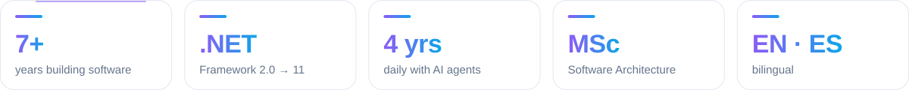
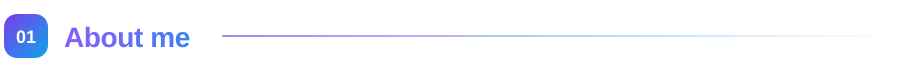

<!-- Header -->
<p align="right">
  <b>English</b> · <a href="README.es.md">Español</a>
</p>

<p align="center">
  <picture>
    <source media="(prefers-color-scheme: dark)" srcset="assets/hero-dark.svg" />
    
  </picture>
</p>

<p align="center">
  <a href="https://git.io/typing-svg">
    
  </a>
</p>

<p align="center">
  <a href="https://robertogallardo.dev"></a>
  <a href="https://linkedin.com/in/robgallardof"></a>
  <a href="https://github.com/robgallardof?tab=repositories"></a>
</p>

<p align="center">
  
  
  
</p>

<p align="center">
  <picture>
    <source media="(prefers-color-scheme: dark)" srcset="assets/facts-en-dark.svg" />
    
  </picture>
</p>

<p align="center">
  <a href="#about"></a>
  <a href="#building"></a>
  <a href="#toolbox"></a>
  <a href="#stack"></a>
  <a href="#projects"></a>
  <a href="#experience"></a>
  <a href="#stats"></a>
</p>

<p align="center"></p>

<a id="about"></a>
<p align="center"></p>

<p align="center"></p>

<p align="center"><i>I read the legacy code before judging it — then leave it better than I found it.</i></p>

<table>
<tr>
<td width="50%" valign="top">

🏗️ **By day:** backend services in **.NET** for a global logistics company.

</td>
<td width="50%" valign="top">

🔄 **Every .NET generation:** from **.NET Framework 2.0 / 3.5 / 4.x** through .NET Core and **.NET 5 → 10 and 11** — and the migrations in between.

</td>
</tr>
<tr>
<td width="50%" valign="top">

🤖 **4 years with AI:** from ChatGPT to Codex, Claude Code and Antigravity — reviewed and guarded, never blind.

</td>
<td width="50%" valign="top">

🌙 **By night:** AI agents that do real work — editing my videos, publishing them, even doing my taxes.

</td>
</tr>
<tr>
<td width="50%" valign="top">

🔨 **Right now:** building [**RepoRinse**](https://github.com/robgallardof/RepoRinse) and [**Rekora**](https://github.com/robgallardof/rekora), Rust tools for AI coding agents.

</td>
<td width="50%" valign="top">

💬 **Ask me about:** C#, .NET migrations, software design, MongoDB, Vue/Next.js, DevOps and AI agents.

</td>
</tr>
</table>

<p align="center"></p>

<a id="building"></a>
<p align="center"></p>

Tools that let AI coding agents work safely and remember what matters — local, no telemetry, written in Rust.

- 🧠 **[Rekora](https://github.com/robgallardof/rekora)** — verifiable memory for agents: every decision cites its source, stale knowledge is flagged, and tasks hand off cleanly between Claude Code and Codex.
- 🧼 **[RepoRinse](https://github.com/robgallardof/RepoRinse)** — clean commit history and guardrail hooks for Claude Code, Codex, Gemini CLI and Cursor.

```sh
reporinse install --provider git --all --yes            # clean every commit message
reporinse install --provider claude,codex --all --yes   # guardrails for your agents
rekora agent install claude --confirm                   # give Claude Code a memory
```

<p align="center"></p>

<a id="toolbox"></a>
<p align="center"></p>

I build **MCP servers, skills and hooks** so agents can do real work on my machine — locally, with me in control.

<table>
  <tr>
    <th width="33%">🔌 MCP servers</th>
    <th width="33%">🎯 Skills &amp; agent roles</th>
    <th width="33%">🧠 Memory &amp; guardrails</th>
  </tr>
  <tr>
    <td valign="top">
      <a href="https://github.com/robgallardof/davinci-resolve-mcp">davinci-resolve-mcp</a> — video editing<br/>
      <a href="https://github.com/robgallardof/social-publisher-mcp">social-publisher-mcp</a> — publishing<br/>
      <a href="https://github.com/robgallardof/declaracion">declaracion</a> — Mexican taxes
    </td>
    <td valign="top">
      Producer, editors, colorist and QA for Resolve<br/>
      Copywriter, strategist and analyst for social<br/>
      Accountant and auditor for tax returns
    </td>
    <td valign="top">
      <a href="https://github.com/robgallardof/rekora">Rekora</a> — verifiable memory for agents<br/>
      <a href="https://github.com/robgallardof/RepoRinse">RepoRinse</a> — Git &amp; agent hooks<br/>
      Command and path guards for agents<br/>
      A clean, human-only commit history
    </td>
  </tr>
</table>

<p align="center">
  
  
  
</p>

<p align="center"></p>

<a id="stack"></a>
<p align="center"></p>

<table>
<tr>
<td width="50%" valign="top">

<h3 align="center">⚙️ Backend</h3>
<p align="center">
  <br/><br/>
  <code>.NET Framework 2.0–4.8</code> <code>.NET 5–11</code> <code>ASP.NET Core</code> <code>EF Core</code> <code>SignalR</code> <code>WCF</code> <code>VB.NET</code> <code>xUnit + Moq</code>
</p>

</td>
<td width="50%" valign="top">

<h3 align="center">🎨 Frontend</h3>
<p align="center">
  <br/><br/>
  <code>shadcn/ui</code> <code>Framer Motion</code> <code>PWA</code> <code>i18n</code>
</p>

</td>
</tr>
<tr>
<td width="50%" valign="top">

<h3 align="center">🗄️ Data & Cloud</h3>
<p align="center">
  <br/><br/>
  <code>SQL Server</code> <code>MongoDB Atlas</code> <code>SQLite · FTS5</code> <code>Informix</code> <code>Azure Blob</code>
</p>

</td>
<td width="50%" valign="top">

<h3 align="center">🚢 DevOps & Tools</h3>
<p align="center">
  <br/><br/>
  <code>Azure DevOps</code> <code>CI/CD</code> <code>Clean Architecture</code> <code>CQRS</code>
</p>

</td>
</tr>
<tr>
<td width="50%" valign="top">

<h3 align="center">🤖 AI & agents</h3>
<p align="center">
  
  
  
  
  
  
  
  
  
</p>

</td>
<td width="50%" valign="top">

<h3 align="center">🎬 Content & automation</h3>
<p align="center">
  
  
  
  
  
  
  
  
</p>

</td>
</tr>
</table>

<p align="center"></p>

<a id="projects"></a>
<p align="center"></p>

<table>
  <tr>
    <td width="50%" valign="top">
      <h3>🧠 <a href="https://github.com/robgallardof/rekora">Rekora</a></h3>
      <p>Local-first, verifiable memory for AI coding agents: decisions and constraints with their sources, stale detection, tasks and handoffs between agents, served over MCP to Claude Code and Codex.</p>
      <p><code>🆕 New</code> <code>Rust</code> <code>MCP</code> <code>SQLite</code></p>
      <p>
        
        
        
      </p>
    </td>
    <td width="50%" valign="top">
      <h3>🧼 <a href="https://github.com/robgallardof/RepoRinse">RepoRinse</a></h3>
      <p>Keeps repos clean and agents in check: removes AI co-author trailers (keeps the humans), whitespace and invisible Unicode, and adds guardrail hooks for Claude Code, Codex, Gemini CLI and Cursor.</p>
      <p><code>🆕 New</code> <code>Rust</code> <code>Git hooks</code> <code>Agent hooks</code></p>
      <p>
        
        
        
      </p>
    </td>
  </tr>
  <tr>
    <td width="50%" valign="top">
      <h3>🎬 <a href="https://github.com/robgallardof/davinci-resolve-mcp">davinci-resolve-mcp</a></h3>
      <p>Edit in DaVinci Resolve by talking to an AI producer: vertical & horizontal cuts, motion that keeps faces whole, designed captions, music on the beat and QA before every render.</p>
      <p><code>MCP</code> <code>Python</code> <code>Video</code></p>
      <p>
        
        
        
      </p>
    </td>
    <td width="50%" valign="top">
      <h3>📲 <a href="https://github.com/robgallardof/social-publisher-mcp">social-publisher-mcp</a></h3>
      <p>An AI community manager for short-form video: watches your videos, writes the copy for every network, schedules the posts and tells you what worked.</p>
      <p><code>MCP</code> <code>Python</code> <code>Social</code></p>
      <p>
        
        
        
      </p>
    </td>
  </tr>
  <tr>
    <td width="50%" valign="top">
      <h3>🧾 <a href="https://github.com/robgallardof/declaracion">declaracion</a></h3>
      <p>A personal tax assistant for Mexico inside your AI agent: reads CFDI, computes ISR and IVA (RESICO) and guides the filing. Your data stays on your PC.</p>
      <p><code>MCP</code> <code>Python</code> <code>SAT</code></p>
      <p>
        
        
        
      </p>
    </td>
    <td width="50%" valign="top">
      <h3>📚 <a href="https://github.com/robgallardof/wikdoc">wikdoc</a></h3>
      <p>Turn any folder of code into a local knowledge base you can chat with — embeddings + RAG over Ollama, nothing leaves your machine.</p>
      <p><code>Python</code> <code>Ollama</code> <code>RAG</code></p>
      <p>
        
        
        
      </p>
    </td>
  </tr>
  <tr>
    <td width="50%" valign="top">
      <h3>🤖 <a href="https://github.com/robgallardof/wallybot">wallybot</a></h3>
      <p>Self-hosted hub for market analysis, portfolio and AI-assisted trading: explained proposals, your approval and risk controls.</p>
      <p><code>Python</code> <code>AI</code> <code>Self-hosted</code></p>
      <p>
        
        
        
      </p>
    </td>
    <td width="50%" valign="top">
      <h3>🦊 <a href="https://github.com/robgallardof/multig">multig</a></h3>
      <p>Manage many persistent, isolated browser profiles with Camoufox, a Next.js dashboard and a Python backend.</p>
      <p><code>Next.js</code> <code>Python</code> <code>Camoufox</code></p>
      <p>
        
        
        
      </p>
    </td>
  </tr>
</table>

<p align="center"><a href="https://github.com/robgallardof?tab=repositories"><b>➜ See all repositories</b></a></p>

<p align="center"></p>

<a id="experience"></a>
<p align="center"></p>

<p align="center">
  <picture>
    <source media="(prefers-color-scheme: dark)" srcset="assets/widgets/timeline-en-dark.svg" />
    
  </picture>
</p>

<p align="center"></p>

<a id="stats"></a>
<p align="center"></p>

<p align="center">
  <picture>
    <source media="(prefers-color-scheme: dark)" srcset="assets/widgets/overview-en-dark.svg" />
    
  </picture>
</p>

<table>
<tr>
<td width="50%" align="center"><picture><source media="(prefers-color-scheme: dark)" srcset="./profile-summary-card-output/github_dark/1-repos-per-language.svg" /></picture></td>
<td width="50%" align="center"><picture><source media="(prefers-color-scheme: dark)" srcset="./profile-summary-card-output/github_dark/2-most-commit-language.svg" /></picture></td>
</tr>
<tr>
<td width="50%" align="center"><picture><source media="(prefers-color-scheme: dark)" srcset="./profile-summary-card-output/github_dark/3-stats.svg" /></picture></td>
<td width="50%" align="center"><picture><source media="(prefers-color-scheme: dark)" srcset="./profile-summary-card-output/github_dark/4-productive-time.svg" /></picture></td>
</tr>
</table>

<table>
<tr>
<td width="50%" valign="top">

<h3 align="center">🔥 Streak</h3>
<p align="center"><a href="https://git.io/streak-stats"><picture><source media="(prefers-color-scheme: dark)" srcset="https://streak-stats.demolab.com?user=robgallardof&hide_border=true&date_format=j%20M%5B%20Y%5D&theme=github-dark-blue" /></picture></a></p>

</td>
<td width="50%" valign="top">

<h3 align="center">⚡ Recent activity</h3>

<!--START_SECTION:activity-->
<sub>⏳ Updates automatically every 6 hours with my latest pull requests, issues and releases.</sub>
<!--END_SECTION:activity-->

</td>
</tr>
</table>

<h3 align="center">🐍 Contribution snake</h3>

<p align="center">
  <picture>
    <source media="(prefers-color-scheme: dark)" srcset="https://raw.githubusercontent.com/robgallardof/robgallardof/output/github-snake-dark.svg" />
    <source media="(prefers-color-scheme: light)" srcset="https://raw.githubusercontent.com/robgallardof/robgallardof/output/github-snake.svg" />
    
  </picture>
</p>

<p align="center"></p>

<p align="center">
  <i>“Make it work, make it right, make it fast.” — Kent Beck</i>
</p>


