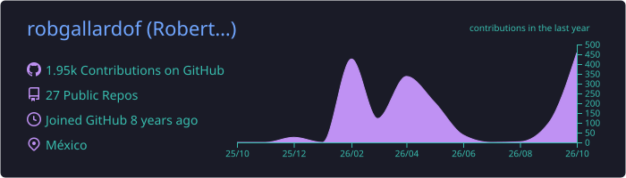
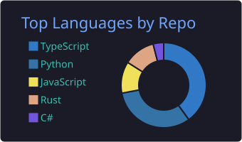
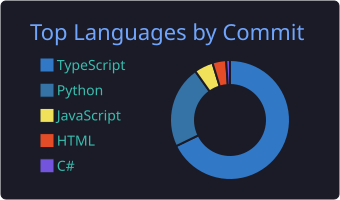
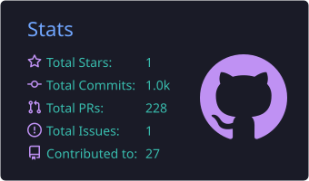
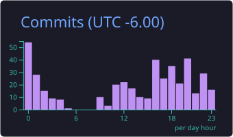

<!-- Header -->
<p align="right">
  <b>English</b> · <a href="README.es.md">Español</a>
</p>

<p align="center">
  
</p>

<p align="center">
  <a href="https://git.io/typing-svg">
    
  </a>
</p>

<p align="center">
  <a href="https://robertogallardo.dev"></a>
  <a href="https://linkedin.com/in/robgallardof"></a>
  <a href="https://github.com/robgallardof?tab=repositories"></a>
</p>

<p align="center">
  
  
  
</p>

---

## 👋 About me

<table>
<tr>
<td width="55%" valign="top">

```csharp
public sealed record Developer
{
    public string Name     => "Roberto Gallardo";
    public string Role     => "Full Stack .NET Developer";
    public string HomeTown => "Guadalajara 🇲🇽 — tortas ahogadas certified";
    public string[] Stack  => [".NET 8", "C#", "Rust", "Vue",
                               "React", "Next.js", "MongoDB"];
    public string[] Loves  => ["Clean Architecture", "SOLID",
                               "CI/CD", "AI agents & MCP"];
    public string Motto    => "Code that works is the minimum. "
                            + "Code that's clear is the goal.";
}
```

</td>
<td width="45%" valign="top">

I read the legacy code before judging it — then leave it better than I found it.

🏗️ **By day:** backend services in **.NET 8** for a global logistics company.<br/><br/>
🌙 **By night:** AI agents that do real work — editing my videos, publishing them, even doing my taxes. 😅<br/><br/>
🧼 **Right now:** shipping [**RepoRinse**](https://github.com/robgallardof/RepoRinse), a Rust CLI that keeps repos clean.<br/><br/>
💬 **Ask me about:** C#, software design, MongoDB, Vue/Next.js, DevOps — or the best taquería in GDL.

</td>
</tr>
</table>

---

## 🧼 Spotlight: RepoRinse

<p align="center">
  <a href="https://github.com/robgallardof/RepoRinse">
    <picture>
      <source media="(prefers-color-scheme: dark)" srcset="https://socialify.git.ci/robgallardof/RepoRinse/image?theme=Dark&font=Inter&language=1&description=1&name=1&owner=1&pattern=Circuit%20Board" />
      
    </picture>
  </a>
</p>

<p align="center"><b>Keep the code. Rinse the noise.</b></p>

<p align="center">
  
  
  
  
  
  
  
  
</p>

A local, deterministic CLI that strips AI co-author trailers (and keeps the humans), cleans whitespace and invisible
Unicode, and plugs guardrails into the native hooks of **Claude Code, Codex, Gemini CLI and Cursor**. It installs
next to your existing hooks and uninstalls byte-for-byte. It is the successor of my little
[`no-ai-coauthor`](https://github.com/robgallardof/no-ai-couathor) hook.

```sh
reporinse install --provider git --all --yes           # clean every commit message
reporinse install --provider claude,codex --all --yes  # guardrails for your agents
```

---

## 🧩 My AI agent toolbox

I build **MCP servers, skills and hooks** so agents can do real work on my machine — locally, with me in control.

<table>
  <tr>
    <th width="33%">🔌 MCP servers</th>
    <th width="33%">🎯 Skills &amp; agent roles</th>
    <th width="33%">🪝 Hooks &amp; guardrails</th>
  </tr>
  <tr>
    <td valign="top">
      <a href="https://github.com/robgallardof/davinci-resolve-mcp">davinci-resolve-mcp</a> — video editing<br/>
      <a href="https://github.com/robgallardof/social-publisher-mcp">social-publisher-mcp</a> — publishing<br/>
      <a href="https://github.com/robgallardof/declaracion">declaracion</a> — Mexican taxes
    </td>
    <td valign="top">
      Producer, editors, colorist and QA for Resolve<br/>
      Copywriter, strategist and analyst for social<br/>
      Accountant and auditor for tax returns
    </td>
    <td valign="top">
      <a href="https://github.com/robgallardof/RepoRinse">RepoRinse</a> — Git &amp; agent hooks<br/>
      Command and path guards for agents<br/>
      A clean, human-only commit history
    </td>
  </tr>
</table>

<p align="center">
  
  
  
</p>

---

## 🛠️ Tech stack

<p align="center">
  <b>Backend</b><br/><br/>
  
</p>
<p align="center">
  <b>Frontend</b><br/><br/>
  
</p>
<p align="center">
  <b>Data · Cloud · DevOps</b><br/><br/>
  
</p>
<p align="center">
  <b>Tools</b><br/><br/>
  
</p>

<p align="center">
  <b>AI &amp; agents</b><br/><br/>
  
  
  
  
  
  
  
  
  
</p>
<p align="center">
  <b>Content &amp; automation</b><br/><br/>
  
  
  
  
  
  
  
  
</p>

<p align="center">
  
  
  
  
  
  
  
</p>

---

## 🚀 Featured projects

<table>
  <tr>
    <td width="50%" valign="top">
      <a href="https://github.com/robgallardof/davinci-resolve-mcp"></a>
      <p>🎬 Edit in DaVinci Resolve by talking to an AI that works like a producer: vertical &amp; horizontal cuts, motion that keeps faces whole, designed captions, music on the beat and QA before every render.</p>
    </td>
    <td width="50%" valign="top">
      <a href="https://github.com/robgallardof/social-publisher-mcp"></a>
      <p>📲 An AI community manager for short‑form video as an MCP server: watches your videos, writes the copy for every network, schedules at 05:00 and tells you what worked.</p>
    </td>
  </tr>
  <tr>
    <td width="50%" valign="top">
      <a href="https://github.com/robgallardof/declaracion"></a>
      <p>🧾 A personal tax assistant for Mexico inside your AI agent: reads CFDI, computes ISR and IVA (RESICO) and guides you through filing. Your data stays on your PC.</p>
    </td>
    <td width="50%" valign="top">
      <a href="https://github.com/robgallardof/wallybot"></a>
      <p>🤖 Self‑hosted hub for market analysis, portfolio and AI‑assisted trading: explained proposals, your approval and risk controls.</p>
    </td>
  </tr>
  <tr>
    <td width="50%" valign="top">
      <a href="https://github.com/robgallardof/wikdoc"></a>
      <p>📚 Turn any folder of code into a local, searchable knowledge base you can chat with — embeddings + RAG over Ollama, nothing leaves your machine.</p>
    </td>
    <td width="50%" valign="top">
      <a href="https://github.com/robgallardof/arquest"></a>
      <p>⚡ A Postman/Thunder‑like HTTP client on Next.js App Router: dark‑mode‑first UI and installable PWA with offline cache.</p>
    </td>
  </tr>
  <tr>
    <td width="50%" valign="top">
      <a href="https://github.com/robgallardof/ruxtbot"></a>
      <p>🎮 Discord bot for Rust: raid planning with pictures, crafting, live servers, player lookups and BattleMetrics alerts, in English and Spanish.</p>
    </td>
    <td width="50%" valign="top">
      <a href="https://github.com/robgallardof/portfolio-roberto-gallardo"></a>
      <p>🌐 My personal portfolio: Next.js, Tailwind and shadcn/ui, bilingual and dark‑mode ready.</p>
    </td>
  </tr>
</table>

<p align="center">
  <a href="https://github.com/robgallardof?tab=repositories"><b>➜ See all repositories</b></a>
</p>

---

## 💼 Experience

| Industry | Role | Period |
|---|---|---|
| 🚚 **Global logistics** | Full Stack .NET Developer — .NET 8, Clean Architecture, CQRS, Docker/K8s, Azure DevOps, Vue, MongoDB | 2023 – present |
| 🏦 **Banking** | .NET Developer — .NET Framework → .NET 5, biometrics, GCM → FCM, Kotlin | 2022 |
| 📡 **Telecom** | Developer — VB.NET / C# / Java, SQL Server, SSRS, Mulesoft | 2019 – 2022 |

## 🎓 Education

| | Degree | School |
|---|---|---|
| 🎓 | **Master's Degree in Software Architecture** | AICAD Business School |
| 🎓 | **Bachelor's in Administrative Computer Systems** | Universidad Veracruzana |

---

## 📊 GitHub stats

<p align="center">
  
</p>
<p align="center">
  
  
</p>
<p align="center">
  
  
</p>
<p align="center">
  <a href="https://git.io/streak-stats"></a>
</p>

## 🐍 Contribution snake

<p align="center">
  <picture>
    <source media="(prefers-color-scheme: dark)" srcset="https://raw.githubusercontent.com/robgallardof/robgallardof/output/github-snake-dark.svg" />
    <source media="(prefers-color-scheme: light)" srcset="https://raw.githubusercontent.com/robgallardof/robgallardof/output/github-snake.svg" />
    
  </picture>
</p>

---

<p align="center">
  <i>“Make it work, make it right, make it fast.” — Kent Beck</i>
</p>


