

<!-- kit:lang -->

<a href="README.md"><picture><source media="(prefers-color-scheme: dark)" srcset="assets/kit/lang-en-01-dark.svg" /></picture></a>&nbsp;
<a href="README.es.md"><picture><source media="(prefers-color-scheme: dark)" srcset="assets/kit/lang-en-02-dark.svg" /></picture></a>

<!-- /kit:lang -->

<picture><source media="(prefers-color-scheme: dark)" srcset="assets/hero-dark.svg" /></picture>

<!-- kit:links -->

<a href="https://robertogallardo.dev"><picture><source media="(prefers-color-scheme: dark)" srcset="assets/kit/links-en-01-dark.svg" /></picture></a>&nbsp;
<a href="https://linkedin.com/in/robgallardof"><picture><source media="(prefers-color-scheme: dark)" srcset="assets/kit/links-en-02-dark.svg" /></picture></a>&nbsp;
<a href="https://github.com/robgallardof?tab=repositories"><picture><source media="(prefers-color-scheme: dark)" srcset="assets/kit/links-en-03-dark.svg" /></picture></a>

<!-- /kit:links -->

  
  

<!-- kit:facts -->

<picture><source media="(prefers-color-scheme: dark)" srcset="assets/kit/facts-en-dark.svg" /></picture>

<!-- /kit:facts -->

<!-- kit:nav -->

<a href="#about"><picture><source media="(prefers-color-scheme: dark)" srcset="assets/kit/nav-en-01-dark.svg" /></picture></a>&nbsp;
<a href="#building"><picture><source media="(prefers-color-scheme: dark)" srcset="assets/kit/nav-en-02-dark.svg" /></picture></a>&nbsp;
<a href="#projects"><picture><source media="(prefers-color-scheme: dark)" srcset="assets/kit/nav-en-03-dark.svg" /></picture></a>&nbsp;
<a href="#toolbox"><picture><source media="(prefers-color-scheme: dark)" srcset="assets/kit/nav-en-04-dark.svg" /></picture></a>&nbsp;
<a href="#experience"><picture><source media="(prefers-color-scheme: dark)" srcset="assets/kit/nav-en-05-dark.svg" /></picture></a>&nbsp;
<a href="#stack"><picture><source media="(prefers-color-scheme: dark)" srcset="assets/kit/nav-en-06-dark.svg" /></picture></a>&nbsp;
<a href="#stats"><picture><source media="(prefers-color-scheme: dark)" srcset="assets/kit/nav-en-07-dark.svg" /></picture></a>

<!-- /kit:nav -->

<!-- kit:wave -->

<!-- /kit:wave -->

<!-- kit:h-about -->

<picture><source media="(prefers-color-scheme: dark)" srcset="assets/kit/h-about-en-dark.svg" /></picture>

<!-- /kit:h-about -->

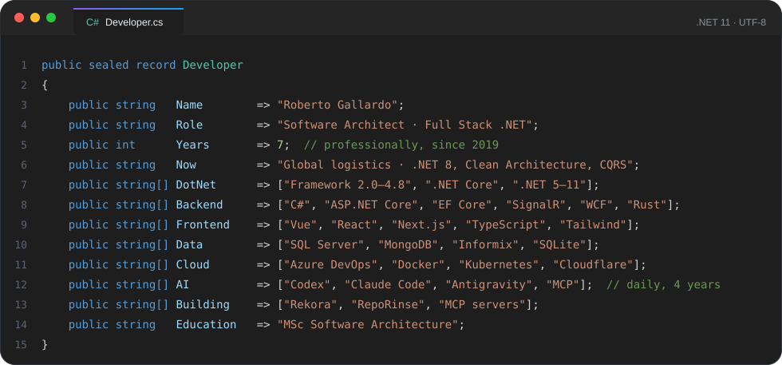

<!-- kit:about -->

<picture><source media="(prefers-color-scheme: dark)" srcset="assets/kit/about-en-dark.svg" /></picture>

<!-- /kit:about -->

<!-- kit:wave -->

<!-- /kit:wave -->

<!-- kit:h-building -->

<picture><source media="(prefers-color-scheme: dark)" srcset="assets/kit/h-building-en-dark.svg" /></picture>

<!-- /kit:h-building -->

Small tools for AI coding agents. I made them because I needed them, and they all run on my own machine.

<!-- kit:building -->

<picture><source media="(prefers-color-scheme: dark)" srcset="assets/kit/building-en-dark.svg" />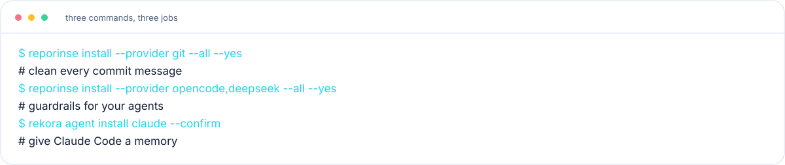</picture>

<!-- /kit:building -->

<!-- kit:wave -->

<!-- /kit:wave -->

<!-- kit:h-projects -->

<picture><source media="(prefers-color-scheme: dark)" srcset="assets/kit/h-projects-en-dark.svg" /></picture>

<!-- /kit:h-projects -->

<!-- kit:projects -->

<a href="https://github.com/robgallardof/rekora"><picture><source media="(prefers-color-scheme: dark)" srcset="assets/kit/projects-en-01-dark.svg" />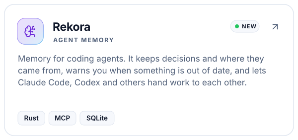</picture></a><a href="https://github.com/robgallardof/RepoRinse"><picture><source media="(prefers-color-scheme: dark)" srcset="assets/kit/projects-en-02-dark.svg" />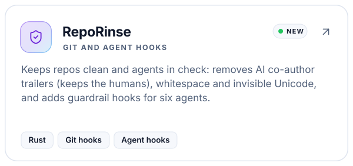</picture></a><a href="https://github.com/robgallardof/qualyx"><picture><source media="(prefers-color-scheme: dark)" srcset="assets/kit/projects-en-03-dark.svg" /></picture></a><a href="https://github.com/robgallardof/davinci-resolve-mcp"><picture><source media="(prefers-color-scheme: dark)" srcset="assets/kit/projects-en-04-dark.svg" />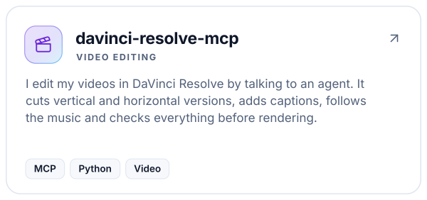</picture></a><a href="https://github.com/robgallardof/social-publisher-mcp"><picture><source media="(prefers-color-scheme: dark)" srcset="assets/kit/projects-en-05-dark.svg" /></picture></a><a href="https://github.com/robgallardof/declaracion"><picture><source media="(prefers-color-scheme: dark)" srcset="assets/kit/projects-en-06-dark.svg" />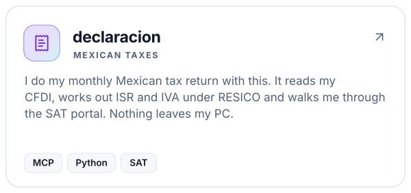</picture></a><a href="https://github.com/robgallardof/agent-mods"><picture><source media="(prefers-color-scheme: dark)" srcset="assets/kit/projects-en-07-dark.svg" /></picture></a><a href="https://github.com/robgallardof/readme-builder"><picture><source media="(prefers-color-scheme: dark)" srcset="assets/kit/projects-en-08-dark.svg" /></picture></a><a href="https://github.com/robgallardof/wikdoc"><picture><source media="(prefers-color-scheme: dark)" srcset="assets/kit/projects-en-09-dark.svg" />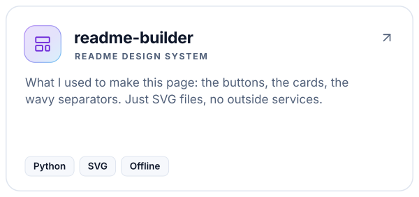</picture></a><a href="https://github.com/robgallardof/wallybot"><picture><source media="(prefers-color-scheme: dark)" srcset="assets/kit/projects-en-10-dark.svg" />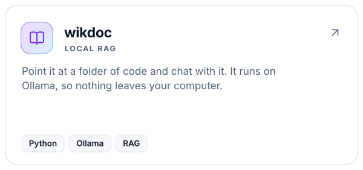</picture></a><a href="https://github.com/robgallardof/multig"><picture><source media="(prefers-color-scheme: dark)" srcset="assets/kit/projects-en-11-dark.svg" />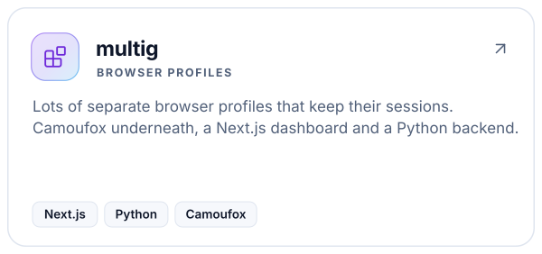</picture></a>

<!-- /kit:projects -->

<!-- kit:all-repos -->

<a href="https://github.com/robgallardof?tab=repositories"><picture><source media="(prefers-color-scheme: dark)" srcset="assets/kit/all-repos-en-01-dark.svg" /></picture></a>

<!-- /kit:all-repos -->

<!-- kit:wave -->

<!-- /kit:wave -->

<!-- kit:h-toolbox -->

<picture><source media="(prefers-color-scheme: dark)" srcset="assets/kit/h-toolbox-en-dark.svg" /></picture>

<!-- /kit:h-toolbox -->

<picture><source media="(prefers-color-scheme: dark)" srcset="assets/widgets/ecosystem-en-dark.svg" />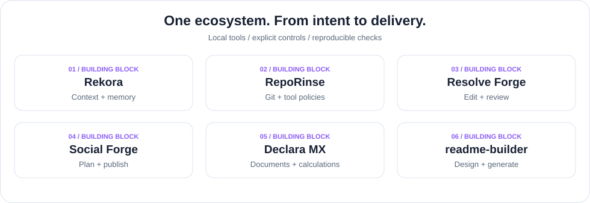</picture>

<!-- kit:toolbox -->

<picture><source media="(prefers-color-scheme: dark)" srcset="assets/kit/toolbox-en-dark.svg" />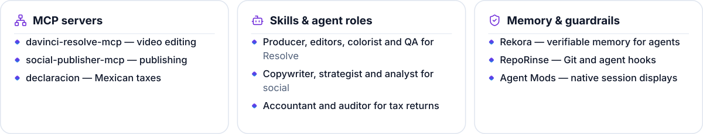</picture>

<!-- /kit:toolbox -->

I like agents that actually get things done, as long as they run on my computer and I can see what they're up to. That's why most of my side projects end up being MCP servers, skills or hooks.

<!-- kit:toolbox-links -->

<a href="https://github.com/robgallardof/rekora/blob/main/docs/architecture/ADAPTERS.md"><picture><source media="(prefers-color-scheme: dark)" srcset="assets/kit/toolbox-links-en-01-dark.svg" /></picture></a>&nbsp;
<a href="https://github.com/robgallardof/RepoRinse/blob/main/docs/integrations/opencode-deepseek.md"><picture><source media="(prefers-color-scheme: dark)" srcset="assets/kit/toolbox-links-en-02-dark.svg" /></picture></a>

<!-- /kit:toolbox-links -->

<picture><source media="(prefers-color-scheme: dark)" srcset="assets/widgets/workflow-en-dark.svg" /></picture>

<!-- kit:wave -->

<!-- /kit:wave -->

<!-- kit:h-experience -->

<picture><source media="(prefers-color-scheme: dark)" srcset="assets/kit/h-experience-en-dark.svg" /></picture>

<!-- /kit:h-experience -->

<picture><source media="(prefers-color-scheme: dark)" srcset="assets/widgets/timeline-en-dark.svg" />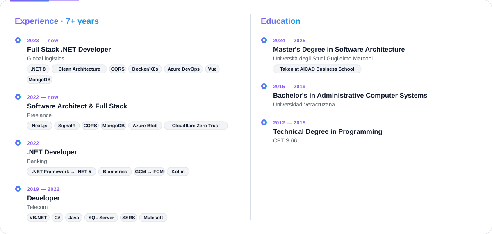</picture>

<!-- kit:wave -->

<!-- /kit:wave -->

<!-- kit:h-stack -->

<picture><source media="(prefers-color-scheme: dark)" srcset="assets/kit/h-stack-en-dark.svg" /></picture>

<!-- /kit:h-stack -->

<!-- kit:stack -->

<picture><source media="(prefers-color-scheme: dark)" srcset="assets/kit/stack-en-dark.svg" /></picture>

<!-- /kit:stack -->

<!-- kit:wave -->

<!-- /kit:wave -->

<!-- kit:h-stats -->

<picture><source media="(prefers-color-scheme: dark)" srcset="assets/kit/h-stats-en-dark.svg" /></picture>

<!-- /kit:h-stats -->

<picture><source media="(prefers-color-scheme: dark)" srcset="assets/widgets/overview-en-dark.svg" />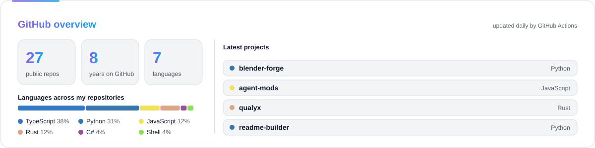</picture>

<picture><source media="(prefers-color-scheme: dark)" srcset="./profile-summary-card-output/github_dark/1-repos-per-language.svg" />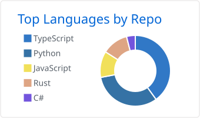</picture><picture><source media="(prefers-color-scheme: dark)" srcset="./profile-summary-card-output/github_dark/2-most-commit-language.svg" />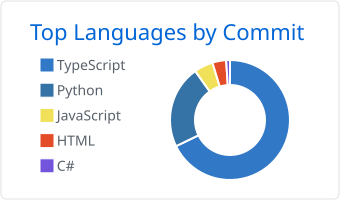</picture>

<picture><source media="(prefers-color-scheme: dark)" srcset="./profile-summary-card-output/github_dark/3-stats.svg" />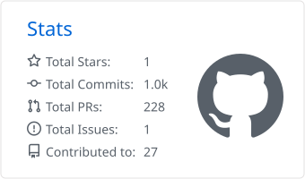</picture><picture><source media="(prefers-color-scheme: dark)" srcset="./profile-summary-card-output/github_dark/4-productive-time.svg" />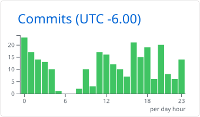</picture>

<a href="https://git.io/streak-stats"><picture><source media="(prefers-color-scheme: dark)" srcset="https://streak-stats.demolab.com?user=robgallardof&hide_border=true&date_format=j%20M%5B%20Y%5D&theme=github-dark-blue" /></picture></a>

<h3 align="center">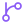 Recent activity</h3>

<!--START_SECTION:activity-->
1. 🎉 Merged PR [#10](https://github.com/robgallardof/wallybot/pull/10) in [robgallardof/wallybot](https://github.com/robgallardof/wallybot)
<!--END_SECTION:activity-->

<!-- kit:wave -->

<!-- /kit:wave -->

<!-- kit:h-arcade -->

<picture><source media="(prefers-color-scheme: dark)" srcset="assets/kit/h-arcade-en-dark.svg" /></picture>

<!-- /kit:h-arcade -->

<a href="https://github.com/robgallardof?tab=overview"><picture><source media="(prefers-color-scheme: dark)" srcset="https://raw.githubusercontent.com/robgallardof/robgallardof/output/contributions-dark.svg" /></picture></a>

Straight from GitHub, updated every hour.

<picture><source media="(prefers-color-scheme: dark)" srcset="https://raw.githubusercontent.com/robgallardof/robgallardof/output/pacman-contribution-graph-dark.svg" /></picture>

<picture><source media="(prefers-color-scheme: dark)" srcset="https://raw.githubusercontent.com/robgallardof/robgallardof/output/github-snake-dark.svg" /></picture>

Made with <a href="https://github.com/abozanona/pacman-contribution-graph">Arcade Contribution Graph</a> and <a href="https://github.com/Platane/snk">snk</a>.

<i>“Make it work, make it right, make it fast.” — Kent Beck</i>

<!-- kit:top -->

<a href="#top"><picture><source media="(prefers-color-scheme: dark)" srcset="assets/kit/top-en-01-dark.svg" /></picture></a>

<!-- /kit:top -->

<!-- readme-builder:signature:start -->

<a href="https://github.com/robgallardof"><picture><source media="(prefers-color-scheme: dark)" srcset="assets/readme/brand/signature-en-dark.svg" /></picture></a>

<!-- readme-builder:signature:end -->
